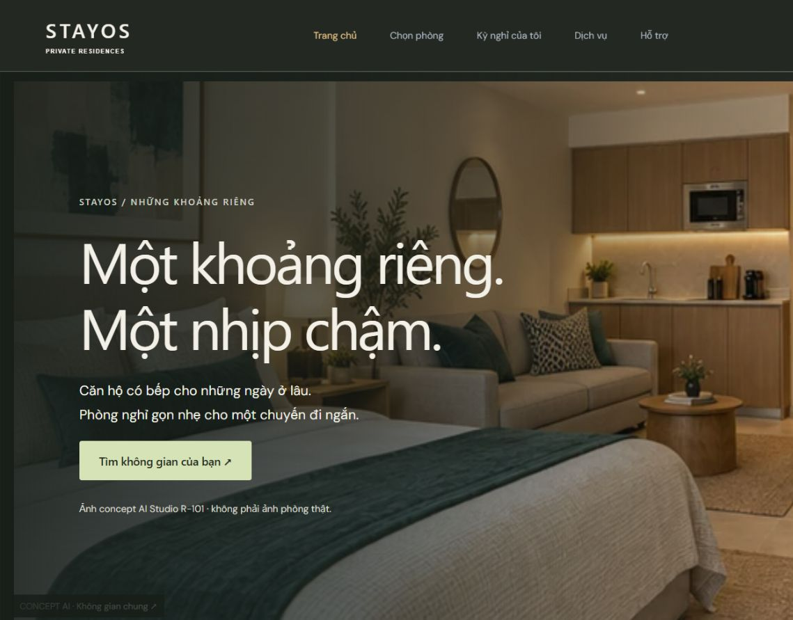
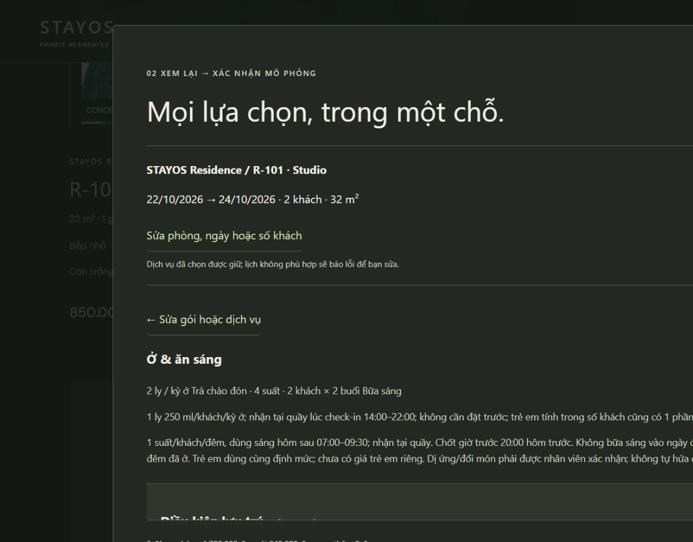
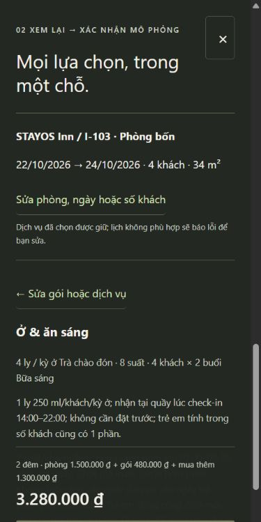

# B/V2 đã vào booking chính — 21/10/2026

[Mở trang chủ chính](http://127.0.0.1:5174/) — không phải trang review.

## Thay đổi đã thực hiện

1. Trang chủ ảnh lớn, nền than ấm, chữ không chân và điểm nhấn xanh; thanh ngày/khách/cơ sở; hai cơ sở và15phòng giữ đúng inventory hiện hành. Chi tiết R-101 có bốn góc concept, gallery toàn màn hình, ảnh nhỏ, phóng to, nút trước/sau, bàn phím và vuốt. Ảnh WebP đi cùng build, không phụ thuộc thư mục review trên server triển khai.
2. Luồng chính: xem phòng → chọn gói → chọn số lượng/lịch dịch vụ → xem lại → đăng nhập giữ lựa chọn → xác nhận đơn mô phỏng → xem lại quyền lợi và lịch đã lưu. Không cần nhảy sang review. Quay lại sửa gói hoặc đổi phòng giữ dịch vụ; lịch không phù hợp báo lỗi, không âm thầm xóa.
3. Server tính gói theo số khách/đêm, kiểm tra phiên bản gói, số lượng, ngày/giờ, hạn12/24giờ, chuyến bay, tồn phòng và tổng tiền. Quà tặng không cộng tiền lần nữa. Lưu snapshot gói/quyền lợi/định mức/lịch/điều kiện cho đơn mới; dữ liệu cũ không bị chuyển đổi sang gói mới.
4. Có hộp thư tư vấn trước đặt không yêu cầu booking; người dùng vẫn đăng nhập để bảo vệ lịch sử trao đổi. Đơn đã hủy có loại hỗ trợ sau kỳ nghỉ; không cho đặt khăn hoặc phục vụ tại phòng đã hủy. Chưa có kênh gọi/email đã xác minh, không bịa thông tin liên hệ.
5. Trạng thái hoàn tất cần xác nhận rõ đã phục vụ/xử lý xong. Server chặn đóng chỉ có phản hồi mà thiếu xác nhận. Bản ghi đóng cũ thiếu dấu xác nhận hiển thị “Đã đóng · chưa xác minh hoàn tất”, không sửa lịch sử hoặc dùng screenshot cũ để chứng minh đã phục vụ.
6. TXT: trạng thái tiếng Việt, ngày và giờ nhận/trả theo chính sách đã lưu, thuế, phí/cọc, sức chứa, gói/quyền lợi, số lượng, lịch dịch vụ và điều kiện. Đơn hủy vẫn có tổng lịch sử, không phải khoản cần trả/hoàn tiền.

## Kết quả thử trực tiếp

Database QA riêng trên5184/API8081, không tạo đơn thử trong database chính:

- I-103 ·22–24/10/2026 ·4khách ·gói ăn sáng ·2set tối23/10lúc18:30: **1.500.000 +480.000 +1.300.000 =3.280.000₫**.
- Qua đăng nhập vẫn giữ phòng, ngày, gói, số lượng/lịch, tổng và bước xem lại.
- Quay lại sửa gói rồi xem lại giữ2set và18:30.
- Xác nhận lưu **ST-B0D820C7**, thấy4ly trà và8suất sáng; dịch vụ lưu2×set/2người,18:30,1.300.000₫,chờ xác nhận.
- Đã hủy đơn thử. Sau hủy gửi được yêu cầu **RQ-39EBB87A**; tư vấn không gắn đơn gửi được **RQ-7FDFB925**.
- Trên5174 không tạo đơn: R-101 →gallery →gói ăn sáng →xem lại1.940.000₫. Đổi R-102 sang R-103 giữ gói ăn sáng và1set tối23/10lúc18:30, tổng tính lại2.590.000₫.
- Mobile390×844: chọn gói, khai lịch, xem lại và xác nhận. Đã sửa lỗi CSS checkbox/label cũ ghi đè; checkbox22px, tổng và CTA cố định, không tràn trang. Gallery dùng mũi tên và Escape đã kiểm tra trên desktop; gesture vuốt đã triển khai nhưng chưa kiểm tra trên thiết bị cảm ứng thật.

14tests Java và28tests web đạt; build thành công. Test bổ sung: tư vấn không có đơn, sau hủy, chặn hoàn tất chưa xác nhận, giá gói server, lịch sai, chống giá giả, idempotency, quyền lợi lưu qua hủy/đọc lại, TXT tiếng Việt/chính sách. Chưa phải chứng nhận accessibility/toàn bộ triển khai sản xuất.

## Bảo toàn dữ liệu cũ

Sao lưu SQLite nhất quán (bao gồm WAL): `data/backups/stayos-before-b-integration-20261021.sqlite`. Chỉ khởi động lại đúng API loopback8080, không bật Demo, không tạo lại admin.

Fingerprint trước/sau không đổi: stay_bookings2dòng, stay_requests2dòng, stay_history5dòng, room_operations0dòng. SHA256 lần lượt:

- 1494648f2541c8095afa56cbea69267dc6d032e4e638fef459b39c7236585798
- f77270fb9f7f955e4c5e87e7950e5c05ebdcbb009f547865e0b5f79ae87e4d24
- e3ef9bb12f9fa591c1c4c278c823e6c9d9b61e0aa24464f1bc170326983fb9c6
- e3b0c44298fc1c149afbf4c8996fb92427ae41e4649b934ca495991b7852b855

## Giới hạn còn lại, không gọi là đã hoàn thiện

- R-101 là phòng mẫu có gallery concept đã duyệt. **14phòng còn lại chưa có bộ ảnh riêng được duyệt**; sơ đồ chỉ ghi minh họa, không coi là ảnh thật hay mặt bằng đã duyệt.
- Gói/giá/định mức mới hoạt động trong đơn demo; chưa được duyệt để kinh doanh. Chính sách hủy demo cũ giữ nguyên; không tự áp chính sách đề xuất trong review.
- Đơn mới có gói chưa đổi ngày tự động, vì cần định mức và lịch quyền lợi mới. UI hướng sang hỗ trợ thay vì đưa báo giá sai; đơn cũ không có gói giữ luồng đổi ngày cũ. Cần hoàn thiện báo giá lại gói có dịch vụ trước khi mở chức năng này cho đơn gói.
- Danh mục thêm dịch vụ sau đặt kiểu cũ chưa thống nhất định mức với gói mới; không xem như đã đạt toàn bộ workflow phục vụ. Đặt mới từ checkout B có đầy đủ số lượng/lịch được kiểm tra tại server.
- Giữ lựa chọn khi quay lại/đăng nhập; chưa lưu phần gói/dịch vụ mới qua tải lại trang hoặc đóng tab. Chưa đo tải trang trước/sau trong cùng điều kiện.
- Chưa thanh toán/hoàn tiền, email xác nhận/khôi phục, dữ liệu liên hệ/địa chỉ/ảnh thực tế và kiểm tra accessibility đầy đủ.

UI/UX Pro Max được dùng để giữ phân cấp ảnh→thông tin→gói, mở dịch vụ khi cần, tổng/CTA luôn gần tay và có nhãn/feedback rõ. Không đưa 3D hoặc tính năng quản trị mới ngoài sửa đúng trạng thái yêu cầu.
