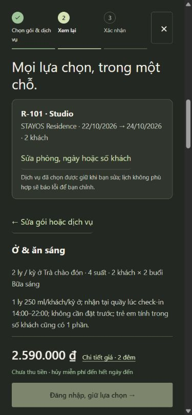

# Kiểm tra tiếp luồng khách B/V2 — 22/10/2026

[Mở booking chính](http://127.0.0.1:5174/).

## Đã xác minh trên giao diện đang chạy

- Trang chính dùng B, không cần sang review để chọn phòng và gói.
- R-101, 22–24/10/2026, 2 khách: gói ăn sáng và 1 set tối ngày23/10 lúc18:30. Tổng **2.590.000₫** = tiền phòng1.700.000 + nâng gói240.000 + tối650.000. Hai ly trà và bốn suất sáng hiển thị **Đã gồm**, không cộng tiền lần nữa.
- Tải lại trang ở bước chọn gói: gói ăn sáng, số lượng1set và ngày/giờ vẫn giữ nguyên. Sau đó đi đến bước xem lại được. Điều này cập nhật giới hạn “chưa giữ gói qua tải lại” trong báo cáo ngày21/10: mã hiện tại đã có chức năng giữ nháp này.
- Mobile390×844: chiều rộng nội dung và chiều cuộn checkout đều375px, không tràn ngang. Tổng và nút tiếp tục nằm trong vùng nhìn thấy. Chưa đánh dấu đồng ý hoặc xác nhận đơn trên database chính.
- Sau kiểm thử đã bỏ set tối, đưa gói về lưu trú mặc định và đóng checkout; không để dịch vụ trả phí thử được chọn sẵn cho người dùng.

## Kiểm thử và dữ liệu

Lần chạy ngày22/10: **54 tests web**, build thành công; **23 tests Java** gồm21 BookingApiTest,1 DatabaseTest,1 LedgerBackupTest — không có lỗi hoặc bài thất bại. Đây là kiểm thử tự động; không có nghĩa mọi chức năng đã được khách độc lập kiểm thử bằng thao tác.

Chỉ kiểm tra giao diện và chạy tests với dữ liệu tạm trong lượt này; không khởi động lại API đang sử dụng hoặc tạo đơn mới trong database chính. Các thay đổi mã hiện có được giữ nguyên, không viết đè bằng bản cũ.

Đối chiếu database chính:2 booking,2 yêu cầu dịch vụ,5 dòng lịch sử,0 room_operations; các SHA256 trùng bản trước tích hợp B:

- booking: `1494648f2541c8095afa56cbea69267dc6d032e4e638fef459b39c7236585798`
- dịch vụ: `f77270fb9f7f955e4c5e87e7950e5c05ebdcbb009f547865e0b5f79ae87e4d24`
- lịch sử: `e3ef9bb12f9fa591c1c4c278c823e6c9d9b61e0aa24464f1bc170326983fb9c6`
- vận hành phòng: `e3b0c44298fc1c149afbf4c8996fb92427ae41e4649b934ca495991b7852b855`

## Không tuyên bố đã xong

- Chỉ R-101 có gallery concept riêng đã duyệt;14phòng còn lại chưa có bộ ảnh riêng. Tất cả đều chưa phải ảnh phòng thật đã xác minh.
- Giá/gói/quyền lợi là demo chưa duyệt kinh doanh. Chưa xác minh địa chỉ/liên hệ hoặc kết nối thanh toán, email và khôi phục mật khẩu thực tế.
- Luồng khách–admin–duyệt đổi ngày chưa được kiểm thử lại toàn bộ bằng thao tác trong lượt22/10 này. Kết quả trước đó thuộc báo cáo tích hợp ngày21/10.
- Chưa có kiểm định accessibility đầy đủ hoặc kiểm tra vuốt trên điện thoại vật lý.
