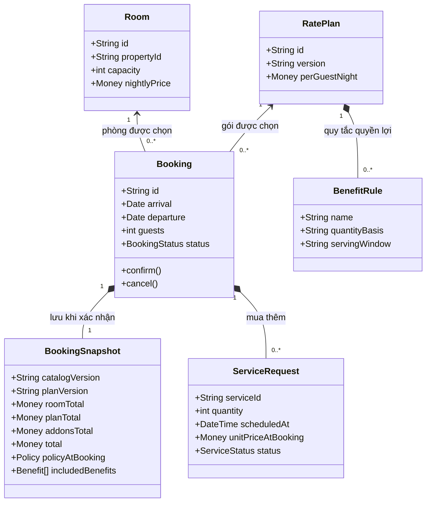
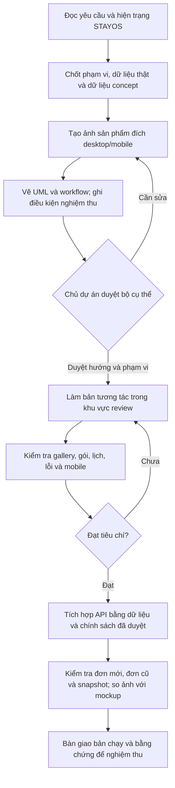

# STAYOS — bộ xem trước khi triển khai

## Bản đang xem: V2 — hiểu phòng trước khi đặt

Sau phản hồi khách hàng, trang `index.html` được làm lại theo góc nhìn khách. Xem `CUSTOMER_REDESIGN_V2.md` để biết thông tin đã bổ sung. Hai ảnh mới là `room-explained-v2.png` (giải thích các khu vực) và `product-preview-v2.png` (mockup trang chi tiết đủ thông tin). `guest-workflow-v2.mmd` bổ sung luồng khách kiểm tra thông tin phòng trước khi so gói. Bản 01 lưu tại `index-v1.html`; ảnh `product-preview.png` bên dưới là ảnh cũ, giữ để đối chiếu. Prompt v2 nằm trong `image-prompts-v2.txt`.

Ngày 20/10/2026. Phạm vi: hướng B, gallery, lựa chọn phòng/gói/dịch vụ và cách tích hợp booking. Đây là thiết kế đề xuất để duyệt, không phải mô tả rằng các chức năng tương lai đã chạy. Không sửa booking chính hoặc dữ liệu đơn cũ.

## 1. Ảnh đích của sản phẩm

Ảnh `product-preview.png` là mockup tạo bằng công cụ imagegen tích hợp, dựa trên hướng B đã chọn. Desktop và mobile dùng cùng nội dung. Ảnh này định hướng hình thức, không phải screenshot sản phẩm đã triển khai; chữ và giá khi lập trình lấy từ dữ liệu cấu trúc.

- Studio R-101: 32 m², tối đa 2 khách, 850.000đ/đêm.
- Minh họa 14–16/11/2026: lưu trú & trà 1.700.000đ; gói sáng 1.940.000đ, 4 suất sáng và 2 ly trà.
- Giữ nền than ấm, điểm nhấn xanh nhạt, ảnh rõ và lớp tối cục bộ sau chữ.
- Gallery cần ảnh riêng từng góc đủ chi tiết. Tạo ảnh lớn từ nguồn nhỏ không tạo thêm chi tiết thực tế. Không biến ảnh concept thành ảnh xác minh.
- Hình món ăn nhỏ trong mockup chỉ minh họa bố cục, không duyệt thực đơn. Khi triển khai phải thay bằng hình đúng khẩu phần/thực đơn đã được chủ cơ sở duyệt; không suy ra món bán từ ảnh AI.

## 2. UML lớp — mô hình đích đề xuất

Tên lớp dưới đây là mô hình khái niệm; chưa khẳng định trùng tên lớp hiện có. Chốt dữ liệu và phiên bản trước khi nối giao diện B với Java API / SQLite.



Giá và quyền lợi đã xác nhận phải được lưu cùng đơn. Đổi giá/gói sau này không thay lịch sử. Quyền lợi bao gồm không bị cộng tiền như dịch vụ mua thêm.

## 3. UML tuần tự — AI dự kiến nối giao diện với booking như thế nào

```mermaid
sequenceDiagram
  actor Guest as Khách
  participant UI as Giao diện B
  participant API as Java API
  participant DB as SQLite
  Guest->>UI: Chọn phòng, ngày, khách, gói, dịch vụ và lịch
  UI->>UI: Kiểm tra dữ liệu và hiển thị giá dự kiến
  UI->>API: Xin báo giá + danh mục/phiên bản
  API->>DB: Kiểm tra phòng trống và dữ liệu đang có hiệu lực
  API-->>UI: Giá server, quyền lợi, điều kiện hoặc lỗi
  UI-->>Guest: Hiển thị đầy đủ trước khi xác nhận
  Guest->>UI: Xác nhận (đăng nhập nếu cần)
  UI->>API: Tạo đơn + requestId + phiên bản báo giá
  API->>DB: Trong giao dịch: kiểm tra lại và lưu đơn/snapshot
  alt Giá hoặc phòng đã thay đổi
    API-->>UI: Từ chối, trả thông tin mới
    UI-->>Guest: Yêu cầu xem lại; không tự chấp nhận giá mới
  else Hợp lệ
    DB-->>API: Đơn và quyền lợi đã lưu
    API-->>UI: Mã đơn + trạng thái thực tế
    UI-->>Guest: Hồ sơ đơn, chi phí, quyền lợi và lịch dịch vụ
  end
```

Luồng này là mục tiêu tích hợp. Trạng thái lưu đơn, giữ phòng, thanh toán và xác nhận phục vụ phải tách rõ; không hiện thanh toán thành công khi chưa có kết quả thanh toán.

## 4. Workflow làm việc của AI — thứ tự trước khi code



Trong lượt hiện tại chỉ làm bộ xem trước. Không suy ra quyền lợi thương mại, địa chỉ hoặc nhà cung cấp từ ảnh AI. Phê duyệt hình thức không đồng nghĩa phê duyệt giá/chính sách hoặc cho phép mở bán.

## 5. Tiêu chí để so kết quả AI với bản duyệt

| Nội dung | Cách xác nhận |
|---|---|
| Hình thức | So screenshot desktop/mobile cùng kích thước với ảnh đích; kiểm tra crop, hệ chữ, màu, nhịp ảnh |
| Gallery | Mở/đóng, phím, thumbnail, zoom/kéo, vuốt, focus và reduced motion |
| Giá/quyền lợi | 2 khách × 2 đêm: 1.700.000đ hoặc 1.940.000đ; 4 suất sáng + 2 ly trà, không cộng hai lần |
| Đặt dịch vụ | Số lượng, ngày/giờ, hạn đặt trước và lịch hiển thị đúng trong phiếu/đơn |
| Dữ liệu | Server tính giá, danh mục khớp phiên bản; đơn cũ không tính lại bằng giá mới |
| Hiệu năng | So trước/sau bằng build, cache trống và cùng mạng/CPU; báo dung lượng tách riêng thời gian tải |

Prompt tạo ảnh được lưu trong `image-prompt.txt`. UML và workflow có bản Mermaid chỉnh sửa được trong tài liệu này; bản SVG xem nhanh nằm cạnh tài liệu.
